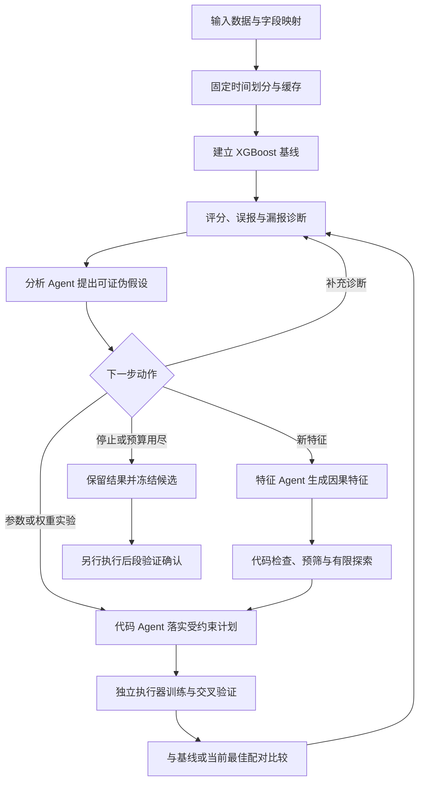

# final · 器件故障预测三 Agent 实验框架

面向「大模型驱动的复杂系统自检自愈与自优化挑战赛」A 题的实验框架。当前版本 **v3.1**：由分析、特征、代码三个角色围绕 XGBoost 进行有证据的参数和特征迭代，区分误报、漏报与数据覆盖问题，保存每次实验的计划、模型、结果和失败原因。

**这是经过工程验证的修复版，不代表比赛全部指标已完成，也不代表预测性能已达到目标。** 本机和 Linux 服务器各通过 67 项测试；真实冻结训练样本上的设备权重核验通过。详见 [验证报告](docs/validation.md) 和 [比赛要求及实现状态](docs/competition_requirements.md)。

## 框架如何工作



- **分析 Agent**：读取实验和诊断证据，提出假设、竞争解释、预计 TP/FP/FN 变化及否定条件。
- **特征 Agent**：先理解字段语义，再生成受限制的历史统计和组合特征；不能访问未来标签来构造特征。
- **代码 Agent**：落实控制器接受的训练计划；不能自行改写评价规则。
- **控制器与执行器**：负责合法动作、预算、缓存身份、模型训练、错误分类、结果持久化和恢复边界。

当前供应商适配使用 DeepSeek。框架角色是受约束的实验接口，不具备任意设备物理含义推断或无限制自主改代码的能力。

## 核心能力

1. **双向错误诊断**：高分 TP/FP 对比、FN/TN 对比和 error atlas；漏报进一步区分没有及时预测机会、没有及时分数、分数低于阈值。
2. **特征筛选与有限探索**：balanced 模式允许误报或漏报方向的证据进入训练；缺少单变量信号时，需要给出探索理由并消耗持久化预算。
3. **设备权重对照**：同一批冻结采样上，仅改变基础权重；保留采样补偿比例，每台保留训练设备的总基础权重为 1。
4. **可选独立补充分支**：固定单阶段父模型，训练独立浅树分支，可提升父模型原本给低分的样本；是否受益由对照决定。
5. **模型及结果可追溯**：会话隔离、代码和数据哈希、训练计划、模型、分数、诊断、调用次数与 token 用量均有记录。
6. **共享 Agent 方法**：[skill](skills/device-failure-experiment-loop/SKILL.md) 及其共享方法进入实际角色调用。

内存的原始比特和空间特征属于设备适配器，不是所有领域通用的物理假设。本框架不是 M²-MFP 或其完整 Multi-BSFE 方法的复现。

## v3.1 修复了什么

| 审查问题 | 当前行为 |
|---|---|
| 新输入 init 后缺少缓存，prepare/run 无法启动 | 新会话自动按映射规范化 TRAIN/VAL 缓存，并在首次实验前设置默认 CV 所需路径与窗口 |
| 从旧会话初始化后，设备权重被冻结采样拒绝 | 保留冻结行号、标签和采样补偿，在训练设备内归一化权重；真实 CV 路径已验证 |
| 目录名包含 memory 时普通错误被判成资源问题 | 根据结构化异常类别判断；普通失败结束该训练，明确资源故障才保留 pending 并停止 |

参见 [详细修复说明](README_V3_1_修复说明.md)。改变程序后应创建新会话或实施可追溯迁移，不能改写旧会话的 code seal 来绕过校验。

## 快速开始

需要 Python 及 [requirements.txt](requirements.txt) 中的依赖。已验证 Windows Python 3.13 / XGBoost 3.4.1，以及 Linux Python 3.10 / XGBoost 3.2.0。

```bash
python -m pip install -r requirements.txt
python -m unittest discover -s tests -v
```

将 [映射示例](examples/mapping_example.json) 改成实际数据字段，并提供可信的故障定义、设备标识、观测时间和随访规则。`init` 的数值数据规范化不等于任意原始日志的特征工程。

```bash
python agent.py init --data /path/to/data --workspace /path/to/workspace --domain memory --mapping /path/to/mapping.json --config examples/runtime_small.json
python agent.py prepare --session /path/to/new_session
python agent.py run --session /path/to/new_session
```

运行时在进程环境中设置 `DEEPSEEK_API_KEY`；不要提交密钥文件。示例配置采用 GPU，CPU 环境请将 `device` 改为 `cpu`。首轮 4 组是示例预算，可通过正式资源配置调整。

从已有会话的数据缓存新建实验：

```bash
python search_step.py --initialize-from /path/to/old_session --session /path/to/new_session --arm arm_policy.json
```

这个入口复用缓存和冻结采样，**不导入旧模型或完整实验历史**，会建立新基线。不要把不同数据集的缓存作为同一数据版本混用。

## 评价与当前边界

- 内存域采用固定的设备级故障评分和 7 天任务口径；其他域有对应的期间设备级评分。比较需具有相同评价身份。
- TRAIN 内 CV 按设备留出，设备的多个评价期整体参与配对重采样。训练设备可能含有与评分期重叠的时间数据，**不等同于严格的未来时间外推**。
- CV 参与特征、步数和阈值选择，最优 CV 分数是搜索证据，不是独立测试结论。
- 后段 VAL 确认须在搜索结束后进行；当前探索入口禁用 TEST。
- 已补充 [TypeA 现成模型用于 TypeB 的探索性测试](experiments/2026-10-29-typea-on-typeb/report.md)，并完成 [v3.2 搜索及共同 66 特征的 B-only、A-only、A+B、小规模 A 对照](experiments/2026-10-29-memory-v32-common66/report.md)。该固定方案下加入 A 未改善 B 的历史 TEST；这不证明样本数量是唯一原因。光放大器真实跨域效果仍未验证。
- 模型复杂度/参数量、单次推理时延、Accuracy、无人干预比例和预设目标达标统计仍需补充。

## 文档与证据

- [2026-10-29 v3.2：38 组实验、共同 66 特征对照及追加 TEST](experiments/2026-10-29-memory-v32-common66/README.md)
- [2026-10-29 TypeA 模型用于 TypeB：报告、事件及测试证据](experiments/2026-10-29-typea-on-typeb/README.md)
- [2026-10-29 TypeA / TypeB 实验 session、事件日志与补充测试报告](experiments/2026-10-29-memory-v31/README.md)
- [框架与模块说明](docs/architecture.md)
- [比赛要求、交付清单和实现状态](docs/competition_requirements.md)
- [测试与真实样本验证](docs/validation.md)
- [可机器读取的验证摘要](evidence/validation_summary.json)
- [v3.1 修复说明](README_V3_1_修复说明.md)
- [Agent skill](skills/device-failure-experiment-loop/SKILL.md)

公开仓库提供源码、测试、方法文档和验证摘要；用户授权公开的实验审阅快照放在 `experiments/`，其中包含事件、调用记录、结果及指定模型。大型原始数据、特征缓存和完整续跑环境仍保留在实验服务器，排除项见各快照的导出清单。API 密钥和登录凭据不得提交。
