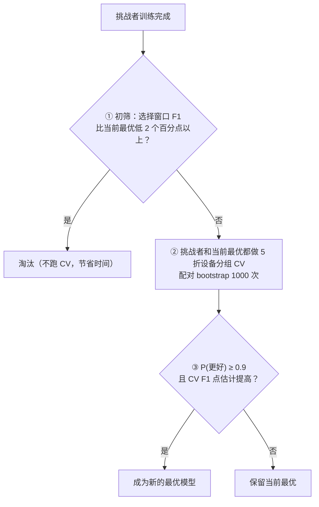

# 采纳规则与部署工作点

本文说明两件事：搜索中一个新模型**凭什么取代当前最优模型**（采纳规则），以及最终部署时**用第几轮的模型、报警阈值取多少**（工作点）；同时说明为什么这样设计。版本之间的变化见 CHANGELOG。

## 1. 采纳规则

每训练完一个新模型（挑战者），控制器按下面三步判断，全程不需要 Agent 参与：

1. **初筛**（`screen_margin=0.02`）：只用来省时间。选择窗口故障太少，不能用来决定谁更好，只能淘汰明显更差的；
2. **配对比较**：在训练集上做 5 折设备分组 CV，得到每台设备的折外（OOF）预测。然后从设备里有放回地抽样 1000 次（同一台设备的所有时间段放在一起抽），每次在**同一批设备**上分别计算两个模型的 F1，统计挑战者赢的比例 P(更好)；
3. **判断**：P(更好) ≥ 0.9（`accept_probability`）**并且** CV F1 的点估计提高（ΔF1 > `accept_lower_bound`，默认 0），才采纳。

新增命中和丢失命中、新增误报和消除误报都会记录在 `cv_comparison_best.json` 里，交给分析 Agent 参考，但**不作为否决条件**。

| 配置项 | 默认值 | 其他取值 |
|---|---|---|
| `accept_test` | `probability`（P(更好) ≥ `accept_probability`） | `interval_95`：要求 bootstrap 95% 区间下界 > `accept_lower_bound`，更保守 |
| `accept_probability` | 0.9 | 0.5～1 之间 |
| `accept_require_net_hits` | `false` | `true`：丢失的命中多于新增的命中时不采纳，适合更看重召回的场景 |
| `screen_margin` | 0.02 | `1.0`：不做初筛，所有实验都跑 CV。**时间充裕时推荐**，可以去掉选择窗口故障太少带来的偶然淘汰 |

## 2. 部署工作点

采纳规则只决定"哪个模型最好"。最终部署还要确定两个数：用**第几轮**的模型，以及**报警阈值**取多少。

**默认做法（`operating_point=cv_oof`）：** 两个数都取自 CV 的 OOF 结果，也就是 CV 中合并 F1 最高的那一轮和那个阈值。

| 环节 | 实现 |
|---|---|
| 训练 | `xgb_runner.py` 在早停之后继续训练到 `cv_rounds` 轮（只训练、不验证，开销很小），另外保存 `model_full.ubj`。原来的 `model.ubj`（选择窗口上最好的那一轮）保持不变，搜索中的初筛和诊断仍然用它 |
| 选择 | `operating_point.choose()`：把 `model_full.ubj` 截断到 CV 选出的轮数，阈值用 OOF 阈值。双分支模型、没有跑 CV 的模型、旧版本训练的模型，会自动退回到选择窗口的做法，并写明原因 |
| 评估 | `confirm_search.py` 在确认窗口上**同时**评估两种工作点（`deployed` 和 `selection_window`），用搜索没用过的日期直接比较 |
| 冻结 | `agent.py freeze` 记录使用的工作点 |

改成 `operating_point=selection_window`，就会使用选择窗口上选出的轮数和阈值。

**已知假设和风险：** OOF 阈值来自 5 个只见过 80% 设备的折模型，用到全量训练的模型上时，默认两者的分数尺度相近。如果尺度相差较大，阈值会偏高或偏低。例如在一次缺少原始日志特征的 TypeB 实验中，OOF 阈值达到 0.99，测试时只报警了 4 台设备。所以确认窗口上一定要同时看两种工作点的结果。TypeA 的实际对比见 [results/typea_v3.2](../results/typea_v3.2/README.md)：最终模型在历史 TEST 上用 OOF 工作点更好（F1 20.22% 对 19.39%），在确认窗口上却是选择窗口工作点略好（16.4% 对 15.5%）；基线在两个时间段上都是选择窗口工作点更好。也就是说，**OOF 工作点目前还没有表现出稳定的优势**。一个可行的改进是按"报警比例"而不是阈值数值来对齐，这一点还没有实现。

## 3. 为什么这样设计

规则的每一处设计，都对应早期实验中发现的问题。这些理由只依据搜索阶段的证据（CV 和选择窗口），不依赖测试结果：

**为什么用"P(更好) ≥ 0.9"，而不是"95% 区间下界 > 0"？**
CV 中大约只有 270 个故障单元（TypeA），F1 提高 2～3 个百分点的模型，几乎不可能让 95% 区间的下界大于 0。按旧规则，TypeA 和 TypeB 各做了 13 组实验，**一组都没有被采纳**。例如某个 TypeA 挑战者：CV F1 +2.46 个百分点、P(更好) = 0.941，但 95% 区间是 [-0.84, +5.60]，所以被拒绝。"95% 区间下界 > 0" 大致相当于要求 P(更好) ≥ 0.975，门槛太高，搜索就失去了意义。0.9 意味着：如果挑战者其实和当前最优一样好，大约只有 10% 的机会被误采纳，而且误采纳的也只是一个"差不多一样好"的模型。

**为什么"命中不能变少"不再一票否决？**
F1 本身就同时考虑了漏报和误报。上面那个挑战者主要靠减少误报来提高 F1（误报净减少 241 台），但丢失的命中比新增的多 10 台，于是被这条规则拒绝。单独要求命中不能变少，等于只看召回，和 F1 的目标是矛盾的。

**为什么轮数和阈值要用 CV OOF 来选？**
选择窗口里的故障很少（TypeA 51 台，TypeB 只有 10 台）。在这么少的故障上同时挑轮数和阈值，结果会偏乐观：同一个 TypeB 模型换不同的轮数，选择窗口 F1 在 26%～41% 之间波动，报出来的 41% 是其中的最大值，而 CV 估计只有 24%。CV OOF 覆盖整个训练集，故障数是选择窗口的好几倍。

## 4. 诚实声明

- 在确定这套规则之前，项目已经看过早期模型在历史 TEST 时间段上的成绩。上面的理由只用到 CV 和选择窗口的证据，但 **0.9 这个门槛是在看过这些 TEST 成绩之后才确定的**；
- 因此，新规则在旧 TEST 时间段上的表现**不能**作为它更好的独立证据。评价新规则，应该看用新规则重新运行的会话，以及搜索中没有使用过的确认窗口；
- 重复比较会累积风险：一次搜索要做 10 次左右的比较，每次大约有 10% 的误采纳机会。好在每次采纳之后，后面的挑战者都要和新的最优比，一个侥幸进来的模型很难一直保住位置；
- 初筛仍然使用选择窗口：一个好模型如果恰好在选择窗口上运气差，可能在跑 CV 之前就被淘汰。TypeB 的 trial_003 就是这样被淘汰的。时间充裕时，把 `screen_margin` 设为 1.0 就能避免这个问题。

相关代码：`agent.py` 的 `accept()`、`crossval.py` 的 `paired_cv()`、`settings.py`、`operating_point.py`、`xgb_runner.py`、`confirm_search.py`；测试见 `tests/test_operating_point.py`。
