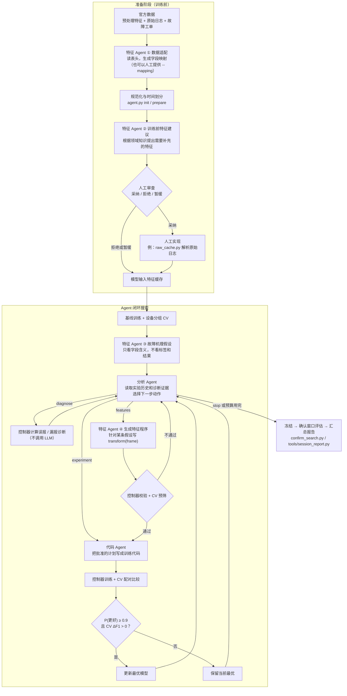
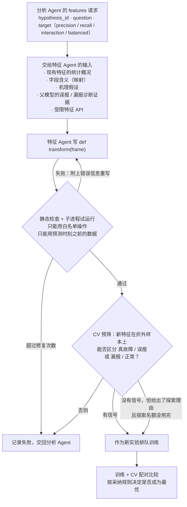

# 三个 Agent 的作用与整体流程

框架里有三个 LLM 角色，分工明确：

| Agent | 一句话概括 | 什么时候被调用 | TypeA v3.2 中的调用次数 |
|---|---|---|---|
| **分析 Agent** | 实验的"决策者"：读证据，决定下一步做什么 | 每完成一组实验、一次诊断，或一次特征请求失败之后 | 25 次（做出 20 个决定：实验 6、特征 6、诊断 8） |
| **特征 Agent** | 负责一切和"数据、特征"相关的工作 | 建立会话、训练前、搜索开始时、分析 Agent 请求新特征时 | 7 次（假设 1 次 + 特征程序 6 次） |
| **代码 Agent** | 把已经批准的实验计划写成可执行的训练代码 | 每组实验训练之前 | 13 次（每组实验 1 次） |

三个 Agent 都**只提出方案、不做最终决定**：数据隔离、训练、评分和"是否采纳"都由普通程序（控制器）按预先确定的规则执行。

## 全流程图



## 分析 Agent：决定下一步做什么

**看到的信息**（`agent.py` 中的 `analyze()`）：
- 当前实验和当前最优模型的指标：选择窗口 F1、CV 的 TP/FP/FN、采纳判断（P(更好)、ΔF1、新增/丢失命中、新增/消除误报）；
- 全部实验历史，以及上一次失败的原因（例如某个特征没通过预筛）；
- 已经做过的诊断证据：误报和漏报的分布、高分真故障与误报的对比、漏报与正常设备的对比等；
- 特征 Agent 提出的故障机理假设；
- 允许改动的范围（超参数上下限、可选因素、特征探索名额）、采纳规则和剩余预算。

**可以选择的动作：**

| 动作 | 含义 | 必须同时给出 |
|---|---|---|
| `experiment` | 改一个因素做对照实验：超参数、随机种子、设备权重、可选的补充分支 | 基于哪个实验、改什么、理由、假设、预期 TP/FP/FN 怎么变、什么结果算假设被否定 |
| `features` | 请特征 Agent 为某条假设写新特征 | 检验哪条假设、要区分哪两类设备、预期效果、否定条件 |
| `diagnose` | 先取得更多证据再决定 | 诊断类型和要回答的问题 |
| `stop` | 结束搜索 | 理由 |

**控制器的把关**（`check_action()`）：
- 一次只能改一个因素（或一组必须一起改的因素），而且不能重复做过的实验；
- 基线之后先做一次参数对照（之前可以先诊断），接着必须做一次特征实验；至少完成 3 组实验、做过 1 次特征实验后才允许停止；
- 每个实验的诊断次数有上限，同一种诊断不能重复做；
- 回复格式不对时，把错误附上让它修正；修正几次还不行，就改用预先定义好的单因素实验（记录为 `controller_fallback`），**不会假装是 Agent 做的选择**。

**不能做的事：** 修改标签、采样方式和评分规则；看到确认窗口或 TEST；自己决定是否采纳。

**例子：** TypeA 中，分析 Agent 在 trial_007 的诊断里发现，220 个漏报中有 207 个"有分数但低于阈值"，于是请特征 Agent 针对这些漏报写特征，得到了最终被采纳的 trial_008。

## 代码 Agent：把批准的计划写成训练代码

**输入：** 已经通过控制器检查的实验计划、示例代码、实验理由。

**输出：** 一个固定格式的训练入口，例如 trial_008 的 [`candidate.py`](../results/typea_v3.2/session/trials/trial_008/attempt_01/candidate.py)：

```python
def run(ctx):
    return ctx.run({'feature_program': '0e508b9d…', 'base_weight': 'device', 'label_horizon_days': 7,
                    'score_aggregation': 'window_max', 'params': {'max_depth': 4, 'learning_rate': 0.1, ...}, ...})
```

**控制器的把关**（`experiment_contract.validate_source()`）：用语法树检查代码只能是 `def run(ctx): return ctx.run(<字面量计划>)` 这一种形式，并且计划要和批准的**完全一致**；不一致就附上错误让它重写。真正的训练由控制器的 `xgb_runner.py` 在子进程里执行。

**说明：** 当前版本有意把代码 Agent 的自由度限制得很小：它不能更换基线、修改参数或特征版本，需要新实验时只能交回分析 Agent。这样做是为了保证"批准的计划"和"实际执行的代码"严格一致、可以复查。放宽这个限制（例如让代码 Agent 修改模型结构，或编写原始日志解析器）是下一步工作。

## 特征 Agent：负责数据和特征

特征 Agent 在流程中出现在四个地方：

| # | 作用 | 什么时候 | 输入 | 输出 | 由谁把关 | 代码 / 记录位置 |
|---|---|---|---|---|---|---|
| ① | **数据适配** | 建立会话时（没有提供 `--mapping` 时） | 数据文件的表头和样例 | 字段映射：哪些列是特征、单位和含义、故障怎么定义、随访怎么算 | 控制器校验格式；故障定义和随访规则要人工核对 | `agent.py adapt` → `mapping.json` |
| ② | **训练前特征建议** | 任何训练开始之前 | 原始数据的字段和训练期样例、已有特征名；**看不到标签和结果** | 需要补充的特征清单：计算方法、因果性、机理、依据及可信度 | **人**逐条决定采纳与否，并负责实现 | `tools/propose_features.py` → `proposals.json`、`adoption.json`、`review.md` |
| ③ | **故障机理假设** | 基线训练完成后、第一次分析之前（每个会话一次） | 只有字段含义；**看不到标签、指标和数值** | 3～12 条可证伪的假设：机理、依据、涉及字段、预期方向、什么情况下算被否定 | 控制器校验字段必须存在；之后的特征请求必须指明检验哪条假设 | `hypotheses.json` |
| ④ | **生成特征程序** | 搜索中，分析 Agent 发出 `features` 请求时 | 现有特征的统计概况、字段含义、假设、父模型的误报/漏报诊断证据、受限的特征 API | 一段 `def transform(frame)` 因果特征代码 | 控制器静态检查、子进程试运行、CV 预筛，最后用 CV 配对比较决定是否采纳 | `feature_jobs/job_XXX/`、`feature_programs/<哈希>/transform.py` |

简单来说：① 和 ② 是**准备数据**（"数据怎么读""还缺什么特征"），③ 是**提出理论**（"故障可能由什么机理引起"），④ 是**动手做实验**（针对某条假设和当前模型的错误，写出新特征来验证）。

TypeA 最终被采纳的 trial_008 就是 ④ 的产物：特征 Agent 用原始日志特征组合出了 4 个新特征（最近新出现的出错列占比、新错误模式速率、错误分散度、分散度 × 错误强度），通过了 CV 采纳检验。

### ④ 生成特征程序的细节



**不能做的事**（为了安全和防止信息泄漏）：
- 读取故障标签、故障时间，或预测时刻之后的数据；
- 在搜索中读取任意文件、调用任意函数（`transform` 只能使用白名单里的 pandas/numpy 操作）；
- 自己解析原始日志：目前由人根据 ② 的建议来实现，由 Agent 自动编写解析器是下一步工作；
- 决定是否采纳：采纳只由预先确定的 CV 统计规则决定。

## 三个 Agent 的共同机制

- **同一份方法：** 每次调用都把同一份 [共享实验方法](../skills/device-failure-experiment-loop/references/experiment-method.md) 和各自的角色提示词（`prompts/analysis.txt`、`feature.txt`、`code.txt`）作为 system prompt 注入；
- **严格的 JSON 回复：** 回复必须是一个 JSON 对象，重复的键和非法数值都会被拒绝；不合格时附上错误让它修正，修正次数有上限；
- **完整记录：** 每次调用的请求（不含密钥）、回复和 token 用量都保存在会话的 `calls/<编号>_<角色>/` 下；
- **预算：** 调用次数（`max_agent_calls`）和 token 总量（`max_reported_tokens`）都有上限，用完会安全停止并保留所有结果；
- **密钥隔离：** API 密钥只在控制器进程中使用，训练和特征子进程拿不到密钥。

相关代码：`agent.py`（`analyze()`、`check_action()`、`train()`、`adapt()`、`hypotheses()`、`features()`）、`providers.py`、`experiment_contract.py`、`feature_contract.py`、`feature_programs.py`、`feature_worker.py`、`contrast.py`、`tools/propose_features.py`。
