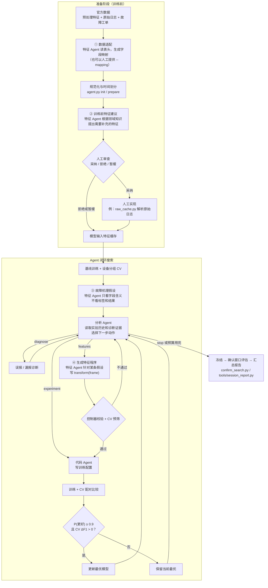
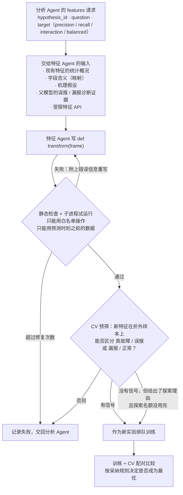

# 特征 Agent 的作用与整体流程

框架里有三个 LLM 角色：**分析 Agent**决定下一步做什么，**代码 Agent**把被接受的计划写成训练配置，**特征 Agent**负责一切和"数据、特征"相关的工作。特征 Agent 在流程里出现在四个地方：

| # | 作用 | 什么时候 | 输入 | 输出 | 由谁把关 | 代码 / 记录位置 |
|---|---|---|---|---|---|---|
| ① | **数据适配** | 建立会话时（没有提供 `--mapping` 时） | 数据文件的表头和样例 | 字段映射：哪些列是特征、单位和含义、故障怎么定义、随访怎么算 | 控制器校验格式；故障定义和随访规则要人工核对 | `agent.py adapt` → `mapping.json` |
| ② | **训练前特征建议** | 任何训练开始之前 | 原始数据的字段和训练期样例、已有特征名；**看不到标签和结果** | 需要补充的特征清单：计算方法、因果性、机理、依据及可信度 | **人**逐条决定采纳与否，并负责实现 | `tools/propose_features.py` → `proposals.json`、`adoption.json`、`review.md` |
| ③ | **故障机理假设** | 基线训练完成后、第一次分析之前（每个会话一次） | 只有字段含义；**看不到标签、指标和数值** | 3～12 条可证伪的假设：机理、依据、涉及字段、预期方向、什么情况下算被否定 | 控制器校验字段必须存在；之后的特征请求必须指明检验哪条假设 | `hypotheses.json` |
| ④ | **生成特征程序** | 搜索中，分析 Agent 发出 `features` 请求时 | 现有特征的统计概况、字段含义、假设、父模型的误报/漏报诊断证据、受限的特征 API | 一段 `def transform(frame)` 因果特征代码 | 控制器静态检查、子进程试运行、CV 预筛，最后用 CV 配对比较决定是否采纳 | `feature_jobs/job_XXX/`、`feature_programs/<哈希>/transform.py` |

简单来说：
- ① 和 ② 是**准备数据**："数据怎么读""还缺什么特征"；
- ③ 是**提出理论**："故障可能由什么机理引起"；
- ④ 是**动手做实验**：针对某条假设和当前模型的错误，写出新特征来验证。

例如 TypeA 最终被采纳的 trial_008，就是 ④ 的产物：分析 Agent 发现大量漏报"有分数但低于阈值"，请特征 Agent 针对这个问题写特征；特征 Agent 用原始日志特征组合出了 4 个新特征（最近新出现的出错列占比、新错误模式速率、错误分散度、分散度 × 错误强度），通过了 CV 采纳检验。

## 全流程图

## ④ 生成特征程序的细节

**特征 Agent 不能做的事**（这些限制是为了安全和防止信息泄漏）：
- 读取故障标签、故障时间，或预测时刻之后的数据；
- 在搜索中读取任意文件、调用任意函数（`transform` 只能使用白名单里的 pandas/numpy 操作）；
- 自己解析原始日志：目前由人根据 ② 的建议来实现，由 Agent 自动编写解析器是下一步工作；
- 决定是否采纳：采纳只由预先确定的 CV 统计规则决定。

相关代码：`agent.py` 中的 `adapt()`、`hypotheses()`、`features()`；特征 API 定义在 `feature_contract.py`；检查和执行在 `feature_programs.py`、`feature_worker.py`；预筛在 `contrast.py`；提示词在 `prompts/feature.txt` 和 `tools/prompts/feature_proposal.txt`。
